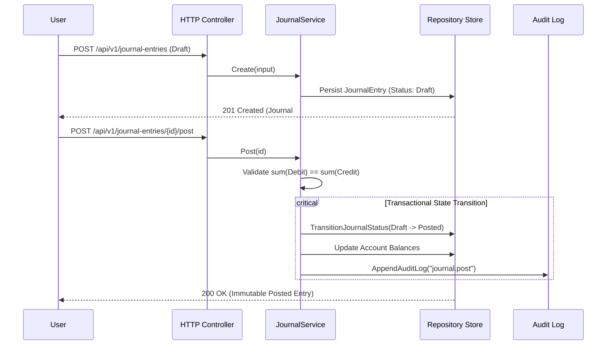

# Architecture & Engineering Design

Tera is built as a double-entry accounting engine designed with Clean Architecture and Domain-Driven Design principles. The application couples a Go backend with a Vue 3 single-page application.

---

## 1. Layered Architecture

```mermaid
graph TD
    subgraph Presentation ["Presentation Layer"]
        CLI[cmd/server & cmd/reseed]
        HTTP[internal/http: Router, Middleware, Controllers]
    end

    subgraph Business ["Business Logic Layer"]
        Service[internal/service: Journal, Invoice, Report, Account, Tax, Company]
    end

    subgraph Persistence ["Persistence Layer"]
        StoreIface[internal/repository: Store & SequenceStore Interfaces]
        MemStore[MemoryStore: sync.RWMutex, deep clone]
        PgStore[PostgresStore: pgx/v5 connection pool, SQL migrations]
    end

    subgraph Domain ["Domain Layer (Zero External Dependencies)"]
        Models[internal/domain: Models, Constants, Errors]
    end

    CLI --> HTTP
    HTTP --> Service
    Service --> StoreIface
    StoreIface <|.. MemStore
    StoreIface <|.. PgStore
    Service --> Models
    StoreIface --> Models
    HTTP --> Models
```

### Layer Responsibilities

1. **Domain (`internal/domain`)**
   - Pure domain models (`Account`, `JournalEntry`, `JournalLine`, `Invoice`, `InvoiceLine`, `InvoicePayment`, `Customer`, `Company`, `Branch`, `AuditLog`, `Session`).
   - Domain errors with HTTP-mapped status codes and validation field mapping.
   - Core accounting constants and type definitions. Zero third-party dependencies.

2. **Repository (`internal/repository`)**
   - Defines the `Store` contract (40+ persistence operations) and `SequenceStore`.
   - **`MemoryStore`**: Thread-safe in-memory store using `sync.RWMutex`, in-memory rollback via deep copy, and embedded seed data. Enables zero-configuration local development and test runs.
   - **`PostgresStore`**: Production PostgreSQL implementation using `pgxpool`, nested transactions, raw SQL queries, and embedded migration tracking (`schema_migrations`).

3. **Service (`internal/service`)**
   - **`JournalService`**: Enforces strict mathematical balance (`TotalDebit == TotalCredit`), prevents editing or deletion of posted entries, and maintains running account balances.
   - **`InvoiceService`**: Manages invoice lifecycle (`Draft` -> `Issued` -> `PartiallyPaid` -> `Paid` / `Overdue`). Automatically generates double-entry journals on issuance and cash receipt journals on payment.
   - **`ReportService`**: Derives balance sheets, profit & loss statements, cash flows, general ledgers, and receivables aging directly from posted journal lines.
   - **`TaxService`**: Calculates Indonesian VAT (PPN 11%) and withholding tax positions.
   - **`AccountService`**: Manages the Chart of Accounts and bootstraps standardized parent-child account hierarchies.

4. **HTTP (`internal/http`)**
   - Method-pattern routing using standard library `net/http` (`ServeMux` with Go 1.22+ pattern matching).
   - Middleware pipeline: Panic recovery, Request ID tracking, Structured JSON logging, Security Headers, CORS, and Bearer Token authentication.
   - Uniform response envelopes: `{ "data": ..., "meta": ..., "errors": [...] }`.

---

## 2. Key Accounting Workflows & Invariants

### A. Journal Posting & Immutability



**Accounting Invariants:**
- Once posted, a journal entry cannot be edited or deleted. Corrections must be recorded via new adjustment entries.
- Draft journal entries never modify account balances and are strictly excluded from all financial reports.

### B. Sales Invoice Issuance with Automatic Journalization

When an invoice transitions from `Draft` to `Issued`:
1. In a single database transaction, `InvoiceService` calculates tax (if company is PKP) and creates a posted double-entry journal:
   - **Debit**: Accounts Receivable (`1200`) — Total invoice amount
   - **Credit**: Sales Revenue (`4100`) — Subtotal amount
   - **Credit**: VAT Payable (`2200`) — Output VAT 11% (if applicable)
2. The invoice status transitions from `Draft` to `Issued`.
3. An audit log row is appended. If any step fails, the entire transaction rolls back.

### C. Cash Receipt Payment Workflow

When recording an invoice payment:
1. Validates that payment amount is positive and does not exceed the outstanding balance.
2. In a single database transaction:
   - Creates a posted cash receipt journal:
     - **Debit**: Cash / Bank Asset Account (`1100` or chosen asset account)
     - **Credit**: Accounts Receivable (`1200`)
   - Records an `InvoicePayment` row referencing the payment journal ID.
   - Updates `PaidAmount` and transitions invoice status to `PartiallyPaid` or `Paid`.
   - Appends an audit log event (`invoice.payment`).

---

## 3. Financial Statements & Balance Computation

Rather than storing precomputed totals that risk divergence, reports derive financial state directly from posted journal lines:

- **Balance Sheet Equation**:
  $$\text{Total Assets} = \text{Total Liabilities} + \text{Total Equity} + \text{Current Period Profit}$$
- **Profit & Loss**:
  $$\text{Gross Profit} = \text{Revenue} - \text{Cost of Goods Sold}$$
  $$\text{Net Income} = \text{Gross Profit} - \text{Operating Expenses}$$
- **Accounts Receivable Aging**:
  Calculates days past invoice due date into discrete buckets: `Current`, `1–30 Days`, `31–60 Days`, `61–90 Days`, and `>90 Days`.

---

## 4. Frontend Architecture

- **Framework**: Vue 3 using Composition API (`<script setup>`).
- **Styling**: Tailwind CSS v4 with custom design tokens (ink, paper, brass, seal, credit, debit).
- **Icons**: Lucide Vue (`@lucide/vue`) SVG icons.
- **Typography**: Locally bundled webfonts (`Newsreader`, `Hanken Grotesk`, `JetBrains Mono`) for zero runtime external font requests.
- **State Management**: Reactive session store with storage persistence, cross-tab synchronization, and CustomEvent event bus.
- **Accessibility**: Semantic HTML landmarks, keyboard navigation, focus trapping in modals, and WCAG 2.1 AA compliance.
